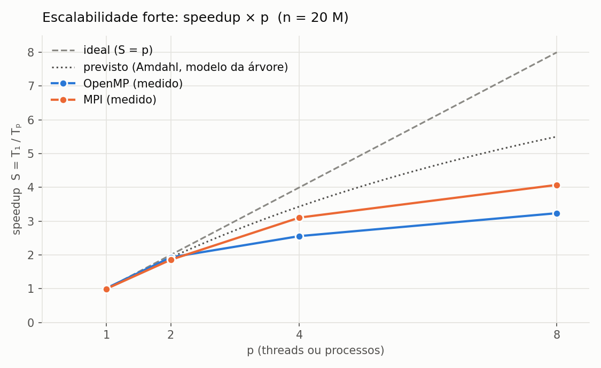

# Projeto Acadêmico CCO085 — Problema 07: Mergesort paralelo

Programação Paralela · IESB 2026/2 · Prof. Rodrigo Gonçalves

Paralelização do mergesort sequencial de referência (`07_mergesort.cpp`, fornecido pelo professor)
em memória compartilhada (OpenMP) e memória distribuída (MPI).

## Resultados

Medição final num Intel Core i5-13420H (12 núcleos lógicos), n = 20 milhões, mediana de 4 repetições.
O baseline do professor leva **1,935 s**.

| p | OpenMP | MPI | Previsto (Amdahl, modelo da árvore) |
|---|---|---|---|
| 2 | 1,93× | 1,86× | 1,92× |
| 4 | 2,56× | 3,11× | 3,43× |
| 8 | 3,24× | 4,07× | 5,50× |

As duas versões dão o mesmo resultado do baseline em todos os 112 casos da bateria de corretude.
Discussão completa em [`docs/analise_experimental.md`](docs/analise_experimental.md).



## Documentação

| Documento | Conteúdo |
|---|---|
| [`docs/analise_baseline.md`](docs/analise_baseline.md) | Complexidade, perfil e previsão de Amdahl (frente 1) |
| [`docs/analise_experimental.md`](docs/analise_experimental.md) | Análise final: speedup medido × previsto, escalabilidade forte e fraca |
| [`docs/contrato.md`](docs/contrato.md) | Regras comuns às versões e checksums de referência |
| [`docs/revisao_arguicao.md`](docs/revisao_arguicao.md) | Perguntas prováveis da arguição, com respostas |
| [`AUTORES.md`](AUTORES.md) | Frente de cada integrante |

## Organização do trio

Comece por [`ORGANIZACAO.md`](ORGANIZACAO.md) (papéis, fluxo de Git, cronograma) e pelo
[`docs/contrato.md`](docs/contrato.md) (o que as três versões têm em comum). Cada frente tem
seu guia em `docs/`. Quem usar IA no repositório: as regras estão em [`AGENTS.md`](AGENTS.md).

## Estrutura

```
mergesort-paralelo/
├── .devcontainer/ ambiente da disciplina (VS Code → Reopen in Container)
├── sequencial/    baseline do professor (cópia sem alteração de lógica) e gabarito
├── comum/         código compartilhado por OpenMP e MPI (docs/contrato.md)
├── openmp/        versão OpenMP
├── mpi/           versão MPI
├── scripts/       validar.sh (corretude), medir.sh (tempos em CSV), graficos.py
├── resultados/    CSVs, resumo de speedup, relatório de validação, máquina usada
├── graficos/      gráficos de tempo, speedup e eficiência
├── docs/          contrato comum, análises, guia de cada frente
├── Makefile
├── ORGANIZACAO.md guia do trio
├── AGENTS.md      instruções para ferramentas de IA
└── AUTORES.md     frente de cada integrante
```

## Rodando do zero

Requisitos: `g++` com OpenMP e OpenMPI (`mpicxx`, `mpirun`). No laboratório já existem;
em casa, abra a pasta no VS Code e use F1 → **Dev Containers: Reopen in Container**
(requer Docker Desktop e a extensão Dev Containers).

Os gráficos usam Python 3 com **matplotlib**, que já vem no contêiner do projeto. Fora dele, se
faltar: `pip install matplotlib` (ou `sudo apt install python3-matplotlib`). Os gráficos da medição
final já estão em `graficos/`, então só é preciso o matplotlib para gerá-los de novo.

```bash
git clone https://github.com/MarceloCPJunior/mergesort-paralelo.git
cd mergesort-paralelo
make                          # compila tudo para bin/
./bin/mergesort_seq 20000000  # baseline: n=20000000  ordenado=SIM  tempo=...
./bin/gabarito 20000000       # checksum de referência (docs/contrato.md)
```

Do zero até os gráficos, em quatro comandos:

```bash
make                             # compila (-O2)
bash scripts/validar.sh          # 1. as versões dão o resultado do baseline?  (resultados/validacao.md)
bash scripts/medir.sh            # 2. tempos com repetição e mediana           (resultados/*.csv)
python3 scripts/graficos.py      # 3. gráficos e tabela de speedup              (graficos/, resultados/resumo.md)
```

Use `bash scripts/...` (e não `./scripts/...`): clones feitos no Windows podem perder a
permissão de execução dos arquivos.

## Validação de corretude

```bash
bash scripts/validar.sh rapido   # segundos: n pequenos, p = 1 a 8
bash scripts/validar.sh          # completo, inclui n = 1.000.003 e 20.000.003
```

`ordenado=SIM` só garante a ordem. Toda versão imprime também um checksum do vetor ordenado
(soma de valor × (posição + 1)), que tem de ser igual ao do gabarito para o mesmo n, com a mesma
entrada (semente 12345) e qualquer número de threads ou processos (`docs/contrato.md`, seção 3).
O `validar.sh` confere isso para vários n e p, incluindo os casos difíceis (n não divisível por p,
n menor que p). Relatório em `resultados/validacao.md`.

## Medições

```bash
bash scripts/medir.sh baseline   # baseline do professor em 5M, 20M e 80M
bash scripts/medir.sh            # tudo: baseline, escalabilidade forte e fraca
python3 scripts/graficos.py      # gráficos em graficos/ e tabela em resultados/resumo.md
```

Cada execução é validada (ordenado=SIM e checksum igual ao gabarito); a 1ª repetição de
cada configuração é descartada. Os dados brutos ficam em `resultados/*.csv` e a
descrição da máquina em `resultados/maquina.txt`.

## Perfilamento

Análise completa (perfil, tempo por nível da árvore e Lei de Amdahl) em
[`docs/analise_baseline.md`](docs/analise_baseline.md).

```bash
make perfil
./bin/mergesort_seq_pg 20000000
gprof ./bin/mergesort_seq_pg gmon.out | head -20
./bin/perfil_trechos 20000000     # tempo por trecho e por nível da árvore
```
